# Self-Healing MLOps Pipeline - Architecture

## High-Level System Architecture

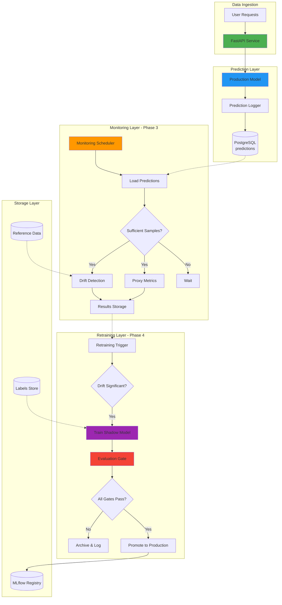

## Phase-by-Phase Flow

### Phase 1-2: Foundation
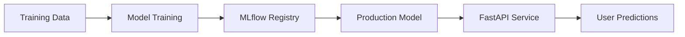

### Phase 3: Monitoring
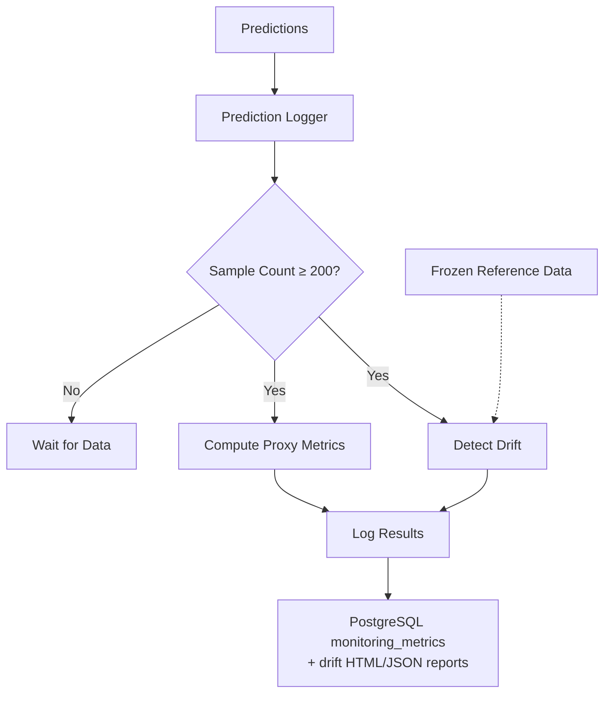

### Phase 4: Self-Healing
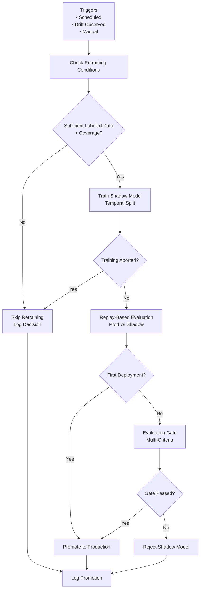

## Component Interactions

### Prediction Flow
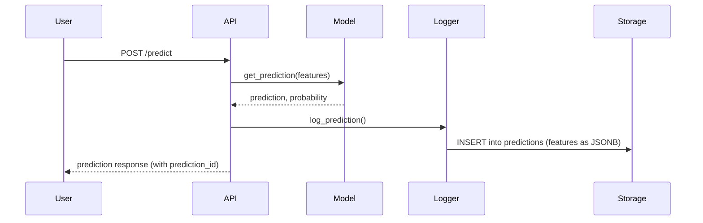

### Monitoring Flow
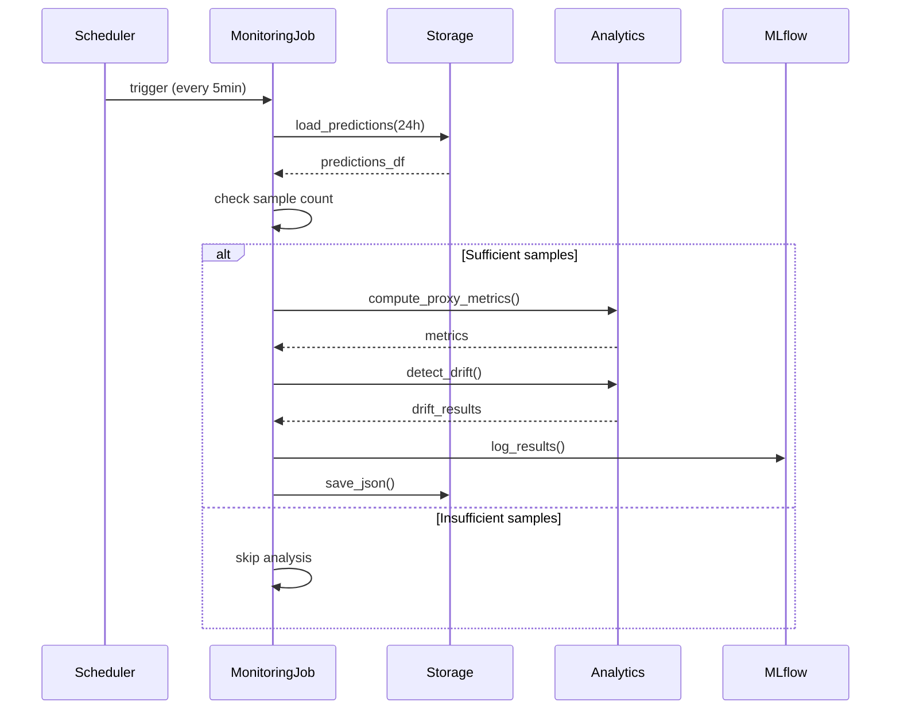

### Retraining Flow
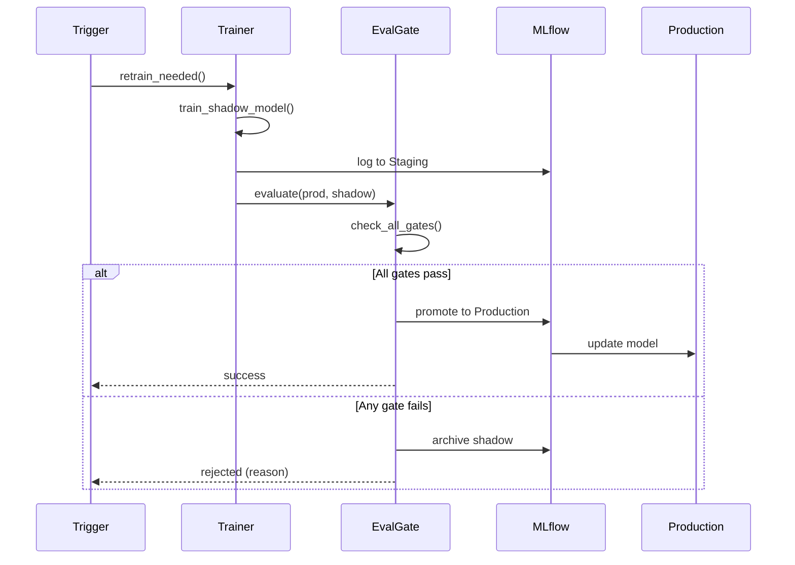

## Data Flow

### Prediction Data Flow
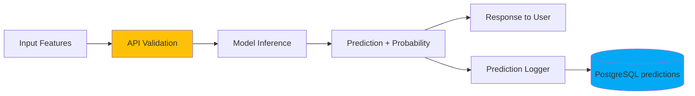

### Label Data Flow (Delayed)
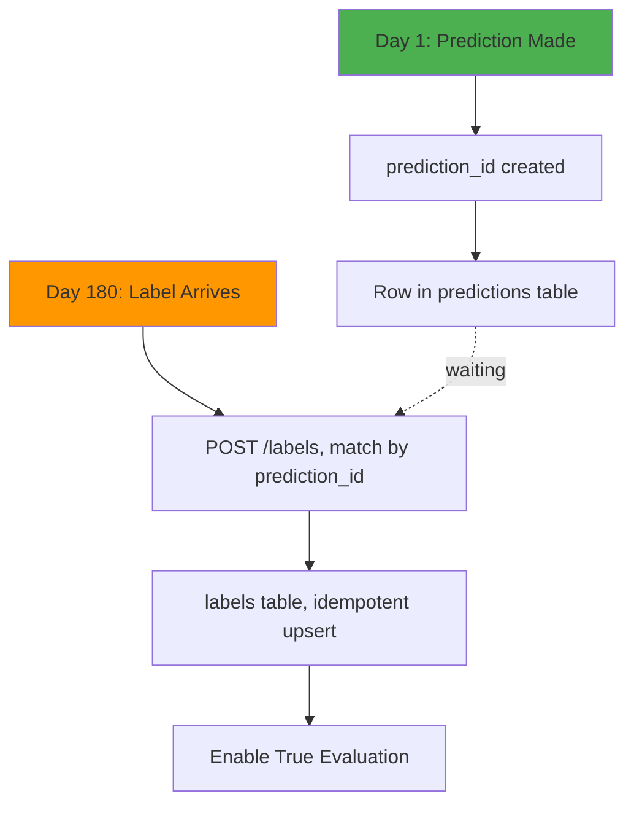

## Storage Architecture

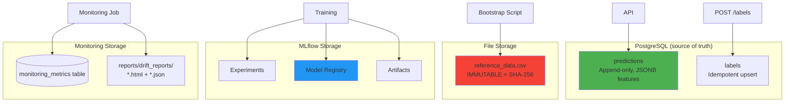

## Deployment Architecture

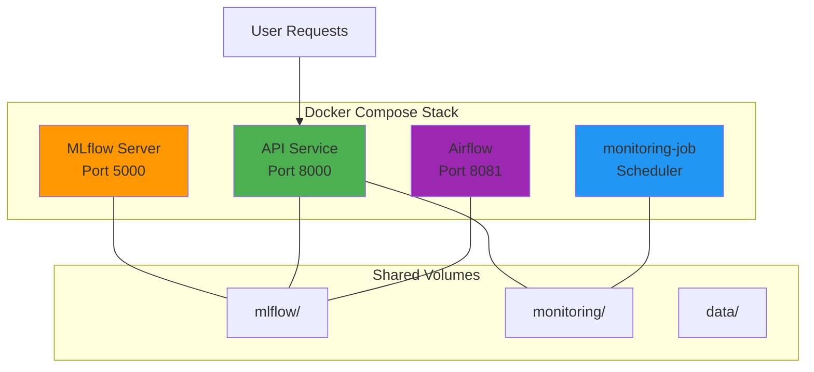

## Key Design Decisions

### 1. Append-Only Predictions (with full feature vectors)
- **Why:** Immutable audit trail; storing the features, not just the score, is what makes
  replay-based evaluation possible
- **Benefits:** No data loss, exact replay of historical requests against any model version
- **Tradeoff:** Storage grows over time (a JSONB blob per prediction)

### 2. Frozen Reference Data
- **Why:** Statistical validity
- **Benefits:** Comparable drift detection
- **Tradeoff:** Manual updates only

### 3. Delayed Labels
- **Why:** Real-world constraint
- **Benefits:** Realistic evaluation gate
- **Tradeoff:** Can't evaluate immediately

### 4. Shadow Model Validation
- **Why:** Safe deployment
- **Benefits:** No production degradation
- **Tradeoff:** Higher infrastructure cost

### 5. Multi-Criteria Gates
- **Why:** Comprehensive evaluation
- **Benefits:** Prevents false promotions
- **Tradeoff:** Complex logic

## Technology Stack

| Component | Technology | Purpose |
|-----------|-----------|---------|
| **API** | FastAPI | High-performance predictions |
| **Model** | scikit-learn RandomForestClassifier | Credit-risk classification |
| **Model Tracking** | MLflow | Experiment + registry |
| **Storage** | PostgreSQL | Predictions, labels, metrics, decisions, lineage |
| **Drift Detection** | Evidently AI | Statistical monitoring |
| **Data Validation** | `src/features/schema.py` (runtime), Pandera (tests/CI) | Schema enforcement |
| **Testing** | pytest | Unit + integration tests |
| **Orchestration** | Airflow | DAG workflows |
| **Containerization** | Docker | Environment consistency |
| **CI/CD** | GitHub Actions | Automated testing |

## Scalability Considerations

### Current Architecture (Single Server)
- ✅ Suitable for < 10k predictions/day
- ✅ Development and testing
- ✅ Monitoring <24 hours history

### Future Scaling (Recommended)
- 🗃️ Move the MLflow backend store from SQLite to PostgreSQL (SQLite is the concurrency ceiling)
- 🔄 Kafka for prediction streaming
- ☁️ Cloud storage (S3) for artifacts
- 📈 Kubernetes for orchestration — a starting point exists under [`kindsetup/`](../kindsetup/)
- 🗄️ Feature store integration
